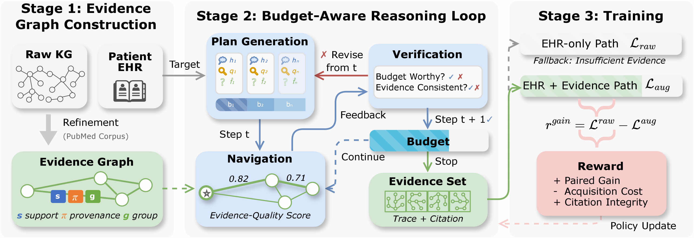
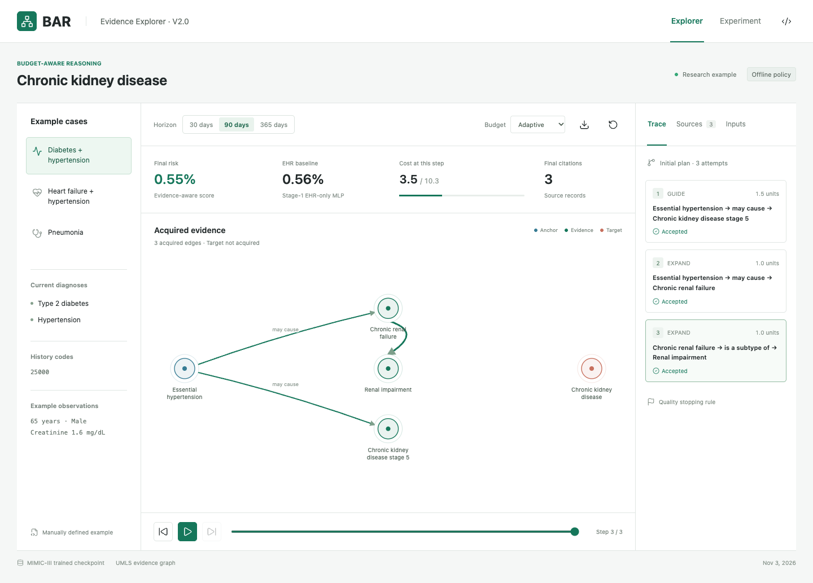

# Cite What You Explore: Budget-Aware LLM Reasoning over Medical KGs with Verifiable Evidence

BAR (**B**udget-**A**ware LLM **R**easoning) combines electronic health records with
source-backed medical knowledge to
predict post-discharge disease risk. It assigns an uncertainty-based exploration
budget, plans and verifies graph queries, and returns a prediction with a trace
and citations. When evidence is insufficient, it returns the frozen EHR prediction.

[Method](#method) · [Quick Start](#quick-start) · [Live Demo](https://chenc2002.github.io/BAR/demo/) · [Data](#data) · [Workflow](#workflow)

[](assets/bar_overview.pdf)

## Method

Given a patient's EHR, a target disease, and a prediction horizon, BAR acquires
a bounded set of knowledge-graph evidence and uses it to predict post-discharge risk.

### 1. Construct the Evidence Graph

Build a disease-specific graph around paths from EHR-linked anchors to the target.
Refinement limits high-degree hubs, filters relations by source support and
provenance, groups equivalent edges, and prepares expansion guides.

### 2. Reason within a Budget

The frozen EHR predictor supplies uncertainty. A training-fitted, task-specific
empirical distribution maps that uncertainty to an exploration budget.

A plan guides queries from patient anchors through the acquired evidence frontier.
The router chooses queries, candidate edges are ranked and selected, and verification
checks evidence before it is accepted. Failed steps can trigger plan revision;
budget, evidence-capacity, and quality conditions determine when exploration stops.

### 3. Predict and Learn

Quality-weighted evidence representations are fused with the EHR representation
to predict risk. The output includes source-backed citations and the acquisition
trace. Insufficient evidence triggers the frozen EHR prediction with no citations.

Training first fits the EHR predictor and freezes its budget and fallback reference.
Uniform-routing warm-up is followed by REINFORCE routing and supervised predictor
updates. Policy rewards combine paired predictive gains, exploration cost, and
citation integrity; paired gains use the same current predictor with and without evidence.

### Code Map

| Stage | Code | What it does |
| --- | --- | --- |
| **Evidence Graph Construction** | [`graph.py`](src/bar/graph.py) | Refine disease-specific graphs using source support, provenance, and equivalent-edge groups |
| **Budget-Aware Reasoning** | [`budget.py`](src/bar/budget.py), [`reasoning.py`](src/bar/reasoning.py), [`policy.py`](src/bar/policy.py) | Assign uncertainty-based budgets; plan, navigate, verify, revise, and stop |
| **Prediction and Training** | [`model.py`](src/bar/model.py), [`training.py`](src/bar/training.py) | Fuse EHR and evidence, learn query routing, and save inference checkpoints |

## Quick Start

Use Python 3.11 or newer to run training and inference:

```bash
git clone https://github.com/ChenC2002/BAR.git
cd BAR
python3 -m venv .venv
source .venv/bin/activate
python -m pip install .
```

Run the included checkpoint on an example and verify all 36 recorded episodes:

```bash
python scripts/predict_demo.py --case example-diabetes --horizon 90 --budget auto
python scripts/predict_demo.py --verify-all
```

Dependencies are defined in [pyproject.toml](pyproject.toml).
`python -m pip install -r requirements.txt` installs the same package.

## Demo

[**Open the interactive demo**](https://chenc2002.github.io/BAR/demo/), or run
`bar demo` after installation.

Explore three CKD examples across 30/90/365-day horizons, vary the budget, and replay
evidence acquisition. The experiment view compares BAR with its frozen Stage-1
EHR-only MLP baseline using the [MIMIC-III run](#mimic-iii-experiment) and an offline policy.

<details>
<summary>Demo preview</summary>

[](https://chenc2002.github.io/BAR/demo/)

</details>

| Download | Size | Contents |
| --- | --- | --- |
| [Offline demo](https://github.com/ChenC2002/BAR/raw/refs/heads/main/downloads/bar-demo-offline.zip) | ~115 KB | Viewer, examples, 36 traces, and evaluation; open `index.html` |
| [Model package](https://github.com/ChenC2002/BAR/raw/refs/heads/main/downloads/bar-demo-model.zip) | ~793 KB | Checkpoint, evidence graph, fitted JSON preprocessing, configuration, and examples |

## Data

Training and prediction accept prepared JSON files following the
[input schemas](src/bar/schemas.py).

| Input | Contents |
| --- | --- |
| Evidence graph | `nodes` and `edges`, including relation, support score, provenance, and optional equivalence groups |
| Training cases | Array of `sample_id`, `disease_id`, `horizon_days`, `ehr_features`, `anchor_ids`, and binary `label` |
| Inference case | One case with the same fields, without `label` |

Disease and anchor identifiers refer to graph nodes. Feature order must stay
consistent across training and prediction. Optional `diagnosis_codes` and
`history_codes` provide context for the reasoning policy. Prepare vocabulary,
source statistics, imputation, and scaling from training data only; keep each
patient in one partition.

## Workflow

### 1. Refine the Graph

Prepare supported source relations and choose frequent anchors from training data:

```bash
bar refine --graph data/graph.json \
  --disease C1561643 --anchor C0085580 \
  --config configs/bar_default.json --out artifacts/ckd.json
bar validate --graph artifacts/ckd.json
```

Use the disease and anchor IDs present in your graph. Refinement retains supported,
source-backed edges and prepares expansion guides for budgeted acquisition.

### 2. Train

```bash
bar train --graph artifacts/ckd.json --data data/train.json \
  --config configs/bar_default.json --policy demo --out artifacts/bar.pt
```

The [configuration](configs/bar_default.json) controls support thresholds,
budgets, evidence limits, model size, and training. `--policy demo` runs offline.
The Python `train(..., validation_cases=...)` API supports validation-based
checkpoint selection with the `experiment` extra installed.

### 3. Predict

```bash
bar predict --checkpoint artifacts/bar.pt --case data/case.json --policy demo
```

Predictions include risk, citations, and a trace of queries, verification decisions,
costs, and the stopping reason. Checkpoints retain the graph, models, and fitted
uncertainty distributions. Fallback returns the frozen EHR score and no citations.

### LLM Policy

```bash
python -m pip install ".[llm]"
export OPENAI_API_KEY=your_key
bar predict --checkpoint artifacts/bar.pt --case data/case.json \
  --policy llm --model YOUR_STRUCTURED_OUTPUT_MODEL
```

Use the same policy options with `bar train` for LLM-guided exploration.
`--base-url` selects a compatible Chat Completions endpoint supporting structured
outputs. LLM weights stay frozen; the query router is learned locally. Diagnosis
context and graph evidence are sent to the endpoint, so use only data and services
permitted by your data-use agreements. Labels and numerical EHR features are not sent.

## MIMIC-III Experiment

The released checkpoint comes from a CKD run with **30,803 patients**, a UMLS
evidence graph, an offline policy, and a 32-hidden-unit MLP. The runner uses ICD-9
`585*` and 30/90/365-day first-recorded diagnosis outcomes after discharge, combining
diagnosis history, demographics, and pre-discharge laboratory summaries.

Patients are assigned to train/validation/test groups in a 70/10/20 ratio, ordered
by earliest eligible discharge. Vocabulary, feature transforms, graph anchors,
and uncertainty distributions are fitted using training data. Checkpoint selection
uses validation macro average precision, early stopping, and two preset configurations;
the selected checkpoint is then evaluated on the held-out test set.

| Resource | Required files |
| --- | --- |
| MIMIC-III | `ADMISSIONS.csv`, `PATIENTS.csv`, `ICUSTAYS.csv`, `DIAGNOSES_ICD.csv`, `LABEVENTS.csv` |
| Knowledge mapping | `ICD9CM_to_UMLS.csv`, `umls/umls.csv`, `umls/concept_names.txt` |

Run on a machine with authorized data access:

```bash
python -m pip install ".[experiment]"
python scripts/run_mimic_demo.py \
  --data /path/to/MIMICIII/data \
  --kg /path/to/KG_mapping \
  --out artifacts/ckd-run --patients 40000
```

The run produces `bar.pt`, `features.json`, the selected configuration, and
evaluation results. Keep record-level outputs on the data host. To update the
viewer from the aggregate results and example cases:

```bash
python scripts/export_demo.py artifacts/ckd-run/public_demo.json --out demo/data.js
```
